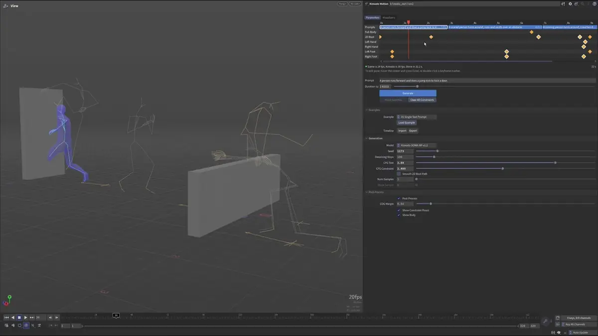
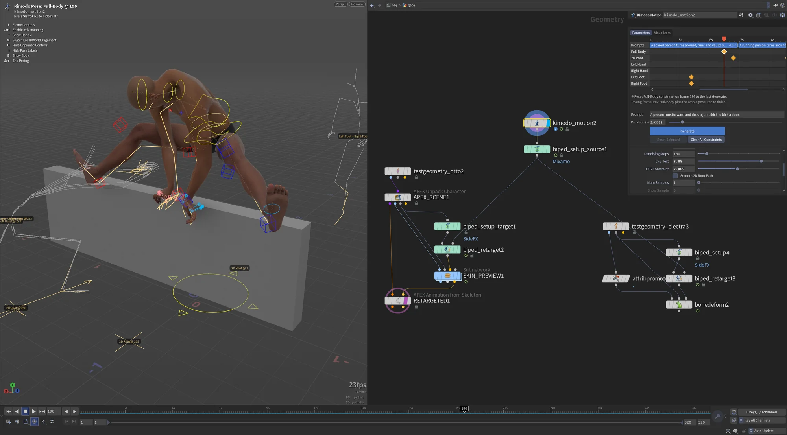
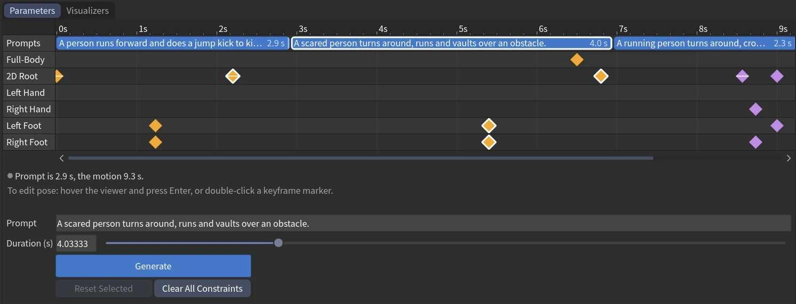
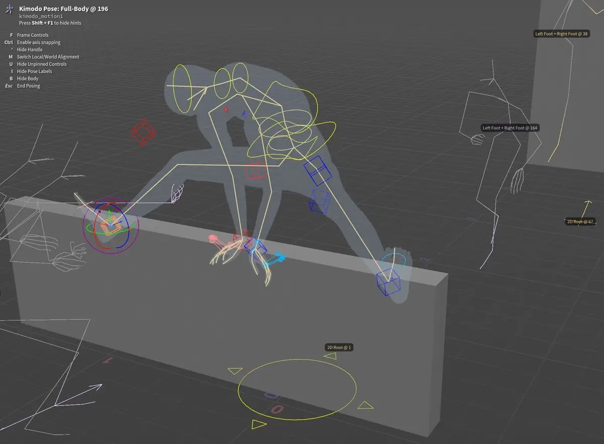
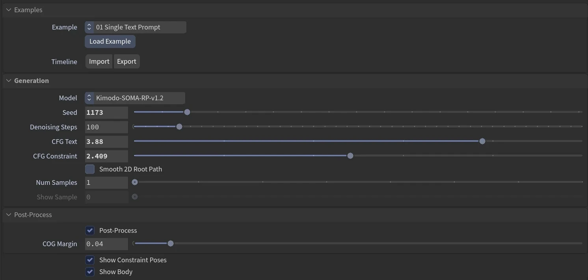

# Kimodo Motion · Houdini APEX

 

Describe an action in natural language, pose constraints on APEX, and [NVIDIA Kimodo](https://github.com/nv-tlabs/kimodo) generates the motion through them, locally on your GPU. It all lives in one node. Out comes a KineFX skeleton with Mixamo joint names.

## Requirements

- Tested on Windows 11, Houdini 22.0.466
- NVIDIA GPU. under 16 GB the text encoder moves to the CPU and wants 32 GB RAM
- ~25 GB disk, internet for the install

Kimodo's text encoder needs Meta-Llama-3-8B-Instruct, so using this means agreeing to the [Meta Llama 3 Community License](https://www.llama.com/llama3/license/). The installer pulls it from [NousResearch/Meta-Llama-3-8B-Instruct](https://huggingface.co/NousResearch/Meta-Llama-3-8B-Instruct) on Hugging Face.

## Install

1. Unzip it into a folder you keep. Houdini loads the tool from there.
2. Close Houdini.
3. Run Install.bat to set up the two models and the environment.

Uninstall.bat unlinks it and deletes the folder if you say so.

## Use

Kimodo Motion is in SOPs. Load one in Example for a quick start.

Type a prompt, set the duration, press Generate. The first one starts the service and loads the models (about 30 s), after that it's a few seconds. The result lives in the node and saves with the hip. Kimodo is 30 fps.

The output always has the rest pose in `rest_transform`, and its joints have Mixamo's names, so Biped Setup takes it without remapping.

Biped Setup with the Mixamo preset straight on the output, then Biped Retarget onto Otto and APEX Animation from Skeleton (left), or onto Electra and Bone Deform (right).

Typical loop: generate, tweak the key poses right on the generated motion, they turn into constraints on the timeline, generate again, repeat.

### Timeline

Clips on top, one track per constraint type under them.

- click the empty space after the last clip to add one. double-click edits its text, drag its right edge for the length (2-10 s), right-click deletes
- Prompt and Duration in the panel edit the selected clip
- click a track: a keyframe there, with the pose shown on that frame.
- Ctrl+drag: a range. (untested)
- drag a key to move it. landing on a key of the same type replaces it
- double-click a key to jump there and edit it
- click, Shift+click and box select as usual, dragging a selected key moves the whole selection
- with the timeline focused: Delete, Ctrl+C/X/V (paste at the current frame), Ctrl+A, Space plays, Left/Right step
- click or drag the ruler for the frame, wheel pans, Shift+wheel zooms
- orange keys match the shown result, light purple ones changed since it was generated

Right-click a key:

- Copy Pose, then right-click a track on another frame to paste. on Full-Body there's Paste Pose and Root, and Paste Pose Only, which leaves the root disk where it is on that frame (good for matching the last frame to the first on a motion that travels)
- Reset Constraint puts it back to its pose from the last Generate
- Change to another constraint type, or Delete
- on a 2D Root key, Constrain Heading: the key also holds which way the hips face, you set it by turning the root disk

On a selected key these act on the whole selection. Under Generate in the panel, Reset Selected resets to last generated status, Clear All Constraints empties every track.

### Posing

Enter in the viewer poses the node, Esc leaves. It's the APEX animate state minus its UI, handles, F and Ctrl as usual. Posing a frame with no key on it makes a Full-Body key there.

- yellow disk on the ground: the root, places and turns the whole character
- big yellow loop at the navel: COG, moves and turns the body. the loop at the hips: pelvis, hips and legs only
- rings: spine, neck, head. blue/red crosses: clavicles
- blue (left) and red (right) boxes: hand and foot IK targets, the ones at elbows and knees aim the limb
- fingers: Kimodo itself has no fingers, its model is 30 joints. Every generated hand comes out in the same relaxed pose; finger poses don't steer the generation
- U hides/shows the controls the frame doesn't pin, I the pose labels, B the body
- a key's pose is drawn in its marker's color, orange, light purple once it differs from the shown result. the limbs that go to Kimodo take that color, the gray-white ones aren't sent

### Constraint types

- Full-Body: the whole pose
- Left/Right Hand, Left/Right Foot: only three things go to Kimodo, the hand or foot itself plus the COG and 2D Root. the rest of the pose on that frame isn't sent, Kimodo generates it
- 2D Root: where the root disk is on the ground, with Constrain Heading also its turn

On a frame with only Hand, Foot or 2D Root keys the controls they don't pin are dimmed and can't be picked, add a Full-Body key there to pose more.

The motion starts at the origin facing +Z. Put a heading on frame 1 to start it another way.

Every key's pose stays drawn in the viewer in its marker's color. The body is display only, the output stays the skeleton.

### Parameters

Examples

- Example, Load Example: Kimodo's bundled SOMA examples, clips, settings and keys. not their `motion.npz`, Generate again
- Timeline Import/Export: your own setups, in the folder format of Kimodo's examples (`meta.json` + `constraints.json`), so the demo reads them too

Generation

- Model: Kimodo checkpoint, v1.2 is the newest. the demo's examples were made with v1
- Seed: same seed and settings give the same motion (42)
- Denoising Steps: more is slower (100)
- CFG Text: how hard the motion follows the prompt (2)
- CFG Constraint: how hard it follows the keys (2)
- Smooth 2D Root Path: joins the 2D Root keys into one path over the motion, like the demo's Make Smooth Path. (unstable for now)
- Num Samples: variations per Generate, up to 8. Show Sample picks the one the node shows

Post-Process

- Post-Process: foot-skate cleanup and constraint enforcement after the model (on)
- COG Margin: how far the COG may sit from where a 2D Root, Hand or Foot key puts it before the cleanup pulls it back, in meters (0.04). Kimodo's root margin. Full-Body keys are exact

Show Constraint Poses and Show Body switch the key poses and the body in the viewer.

## Service

127.0.0.1:44372, log in `service.log`. Quits with the last Houdini that used it.

| env | default | |
|---|---|---|
| `KIMODO_TEXT_ENCODER_DEVICE` | `cuda` | `cpu` keeps the encoder off the GPU. unset, `settings.json` decides, the installer writes `cpu` there under 16 GB |
| `KIMODO_SERVICE_PORT` | `44372` | when the port is taken |
| `KIMODO_SERVICE_IDLE_MINUTES` | `30` | `0` = never |
| `KIMODO_LLAMA_DIR` | `models/Meta-Llama-3-8B-Instruct` | |

## License

Apache-2.0, see [LICENSE](LICENSE).
